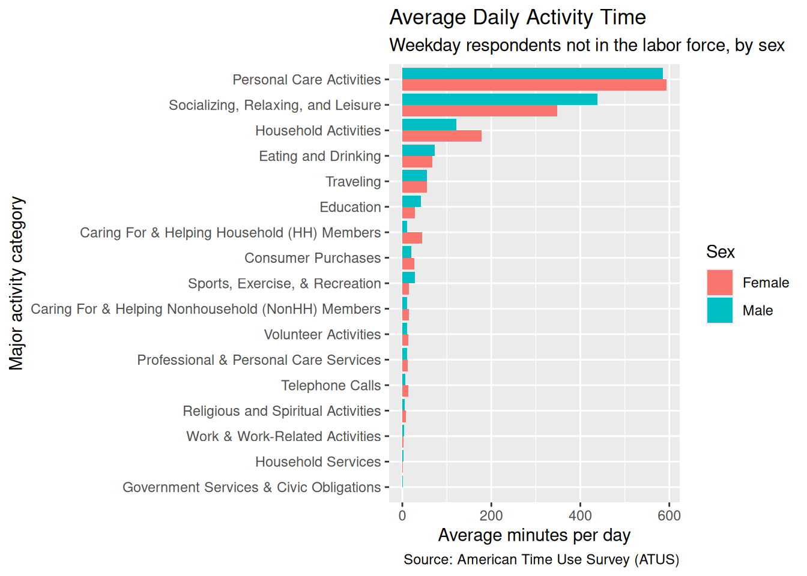
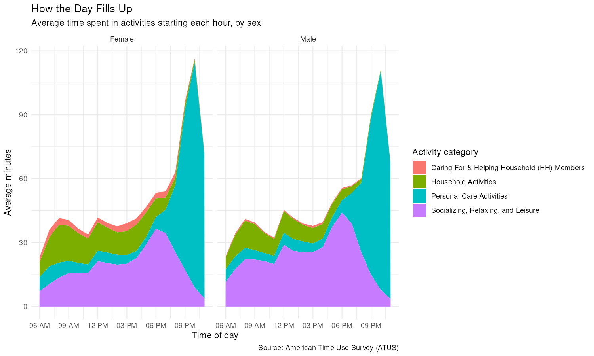

A database table lives on disk and can be arbitrarily large, while a data frame lives in memory. The ATUS activity table you are about to use has 4.9 million rows, which is why it ships as a DuckDB file rather than as a CSV you would read into R.

**dbplyr** is the translator: you write an ordinary **dplyr** pipeline against a database table, it turns the pipeline into SQL, and the database — here DuckDB, running inside your R session through the **duckdb** driver and the **DBI** interface — does the work. R receives only the rows you ask for with `collect()`.

The `activities` table records each diary entry's start time and duration.
`respondents` has one row per person, including sex, age, and employment
status, while `activity_codes` maps numeric codes to category names. The
six-digit `activity_code` encodes a three-level hierarchy: `120303` means
Socializing, Relaxing, and Leisure (`12`) > TV and Movies (`03`) > Watching TV
(`03`). Likewise, `start_hhmm` encodes time in HHMM format, so `1430` means
2:30 PM.


::: {.cell}

:::


::: {.cell}
::: {.cell-output .cell-output-stderr}

```
duckdb keeps downloaded extensions and secrets in a temporary directory:
ℹ /tmp/RtmpCmmzbw/duckdb
This is removed when the R session ends.
• Extensions are re-downloaded each session.
• Secrets are lost.
ℹ Run duckdb(shared_home = TRUE) (or create ~/.duckdb) to keep them (suitable for most users).
ℹ Run duckdb(shared_home = FALSE) to accept the temporary directory (and silence this message).
ℹ See ?duckdb_storage for details and alternatives.
```


:::
:::


::: {.cell}
::: {.cell-output .cell-output-stderr}

```
! Grouped output by "tucaseid" and "sex".
ℹ Override behaviour and silence this message with the `.groups` argument.
ℹ Or use `.by` instead of `group_by()`.
! Grouped output by "sex".
ℹ Override behaviour and silence this message with the `.groups` argument.
ℹ Or use `.by` instead of `group_by()`.
```


:::
:::


That render took as long as the last one, because the aggregation over 4.9
million rows still had to run once to fill `analysis_cache/`. From now on every
render reads the 36-row `activity_avg` back from disk and never touches the
database. The cache is keyed on the chunk's code, not on the database file. If
you ever drop a newer `atus.duckdb` into `data/`, delete `analysis_cache/`
before trusting the numbers.


::: {.cell}
::: {.cell-output .cell-output-stderr}

```
! Grouped output by "sex", "major_code", and "major_name".
ℹ Override behaviour and silence this message with the `.groups` argument.
ℹ Or use `.by` instead of `group_by()`.
```


:::
:::


::: {.cell}
::: {.cell-output-display}
{width=672}
:::
:::


::: {.cell}
::: {.cell-output-display}
{width=672}
:::
:::




