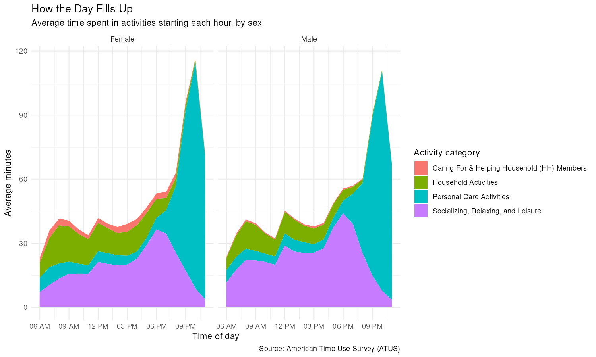

A database table lives on disk and can be arbitrarily large, while a data frame lives in memory. The ATUS activity table you are about to use has 4.9 million rows, which is why it ships as a DuckDB file rather than as a CSV you would read into R.

**dbplyr** is the translator: you write an ordinary **dplyr** pipeline against a database table, it turns the pipeline into SQL, and the database — here DuckDB, running inside your R session through the **duckdb** driver and the **DBI** interface — does the work. R receives only the rows you ask for with `collect()`.

The `activities` table records each diary entry's start time and duration.
`respondents` has one row per person, including sex, age, and employment
status, while `activity_codes` maps numeric codes to category names. The
six-digit `activity_code` encodes a three-level hierarchy: `120303` means
Socializing, Relaxing, and Leisure (`12`) > TV and Movies (`03`) > Watching TV
(`03`). Likewise, `start_hhmm` encodes time in HHMM format, so `1430` means
2:30 PM.

```{r}
#| message: false
library(dplyr)
library(dbplyr)
library(DBI)
library(duckdb)
library(ggplot2)
```

```{r}
con <- dbConnect(duckdb(), dbdir = "data/atus.duckdb", read_only = TRUE)

dbplyr_act <- tbl(con, "activities")
dbplyr_resp <- tbl(con, "respondents")
dbplyr_codes <- tbl(con, "activity_codes")
```

```{r}
#| cache: true
activity_avg <- dbplyr_resp |>
  filter(day_type == "Weekday", employment_status == "Not in labor force") |>
  select(tucaseid, sex) |>
  cross_join(
    dbplyr_codes |>
      filter(major_code != 50) |>
      distinct(major_code, major_name)
  ) |>
  left_join(
    dbplyr_act |>
      inner_join(
        dbplyr_resp |>
          filter(day_type == "Weekday", employment_status == "Not in labor force") |>
          select(tucaseid, sex),
        by = "tucaseid"
      ) |>
      inner_join(dbplyr_codes, by = "activity_code") |>
      filter(major_code != 50) |>
      group_by(tucaseid, sex, major_name) |>
      summarize(minutes = sum(duration_min, na.rm = TRUE)) |>
      ungroup(),
    by = c("tucaseid", "sex", "major_name")
  ) |>
  mutate(minutes = coalesce(minutes, 0)) |>
  group_by(sex, major_name) |>
  summarize(avg_minutes = mean(minutes, na.rm = TRUE)) |>
  arrange(sex, desc(avg_minutes)) |>
  collect()
```

That render took as long as the last one, because the aggregation over 4.9
million rows still had to run once to fill `analysis_cache/`. From now on every
render reads the 36-row `activity_avg` back from disk and never touches the
database. The cache is keyed on the chunk's code, not on the database file. If
you ever drop a newer `atus.duckdb` into `data/`, delete `analysis_cache/`
before trusting the numbers.

```{r}
weekday_respondents <- dbplyr_resp |>
  filter(day_type == "Weekday", employment_status == "Not in labor force") |>
  select(tucaseid, sex)

weekday_sex_counts <- weekday_respondents |>
  count(sex, name = "n_respondents") |>
  collect()

major_categories <- dbplyr_codes |>
  filter(major_code %in% c(1, 2, 3, 12)) |>
  distinct(major_code, major_name) |>
  collect()

hourly_minutes <- dbplyr_act |>
  inner_join(weekday_respondents, by = "tucaseid") |>
  inner_join(
    dbplyr_codes |>
      filter(major_code %in% c(1, 2, 3, 12)) |>
      select(activity_code, major_code, major_name),
    by = "activity_code"
  ) |>
  mutate(hour = floor(start_hhmm / 100)) |>
  filter(hour >= 6, hour <= 23) |>
  group_by(sex, major_code, major_name, hour) |>
  summarize(total_minutes = sum(duration_min, na.rm = TRUE)) |>
  collect()

hourly_avg <- tidyr::crossing(
  weekday_sex_counts,
  major_categories,
  hour = 6:23
) |>
  left_join(
    hourly_minutes,
    by = c("sex", "major_code", "major_name", "hour")
  ) |>
  mutate(avg_minutes = coalesce(total_minutes, 0) / n_respondents) |>
  select(sex, major_code, major_name, hour, avg_minutes) |>
  arrange(sex, major_code, hour)
```

```{r}
activity_avg |>
  filter(major_name != "Data Codes") |>
  ggplot(aes(x = reorder(major_name, avg_minutes), y = avg_minutes, fill = sex)) +
  geom_col(position = "dodge") +
  coord_flip() +
  labs(
    title = "Average Daily Activity Time",
    subtitle = "Weekday respondents not in the labor force, by sex",
    x = "Major activity category",
    y = "Average minutes per day",
    fill = "Sex",
    caption = "Source: American Time Use Survey (ATUS)"
  )
```

```{r}
hourly_plot <- ggplot(
  hourly_avg,
  aes(x = hour, y = avg_minutes, fill = major_name)
) +
  geom_area(position = "stack") +
  facet_wrap(~ sex) +
  scale_x_continuous(
    breaks = seq(6, 23, by = 3),
    labels = \(x) format(
      as.POSIXct(x * 3600, origin = "1970-01-01", tz = "UTC"),
      "%I %p"
    )
  ) +
  labs(
    title = "How the Day Fills Up",
    subtitle = "Average time spent in activities starting each hour, by sex",
    x = "Time of day",
    y = "Average minutes",
    fill = "Activity category",
    caption = "Source: American Time Use Survey (ATUS)"
  ) +
  theme_minimal()

print(hourly_plot)
ggsave(
  "analysis_files/hourly-area-chart.png",
  plot = hourly_plot,
  width = 10,
  height = 6,
  dpi = 150
)
```


